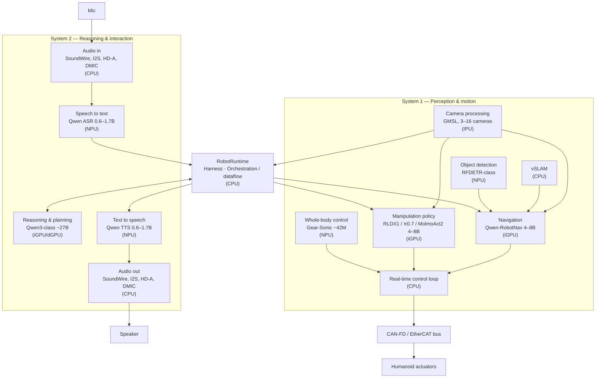

# ADR-0012: Evolve the OpenVINO Physical AI Framework into a System 1 / System 2 RobotRuntime

- **Status:** Proposed
- **Date:** 2026-10-27
- **Deciders:** Robotics & Physical AI Product Management; AI Frameworks Engineering; Platform Architecture; Real-Time/Industrial Communication Engineering
- **Related ADRs:** [0002](0002-five-layer-platform-architecture.md), [0003](0003-consolidate-compute-one-robot-one-soc.md), [0009](0009-real-time-robotics-control.md), [0010](0010-physical-ai-model-enablement.md), [0011](0011-evolve-geti-into-edge-vision-ai-stack.md)
- **Source:** Robotics AI Suite PRD v0.1, Sections 4 & 10 (architectural extension)

## Context and Problem Statement

The OpenVINO Physical AI framework today is primarily a model enablement and
inference path (ADR-0010): it exports, optimizes, and runs individual Physical AI
models on Intel CPU, GPU, and NPU. A complete humanoid or mobile manipulator,
however, is not a single model — it is a set of concurrent workloads that must be
orchestrated together: deliberative reasoning and planning, speech interaction,
perception, navigation, manipulation, whole-body control, and a deterministic
real-time control loop driving the actuators.

These workloads split naturally into two regimes. **System 2** is slow,
deliberative, and language/planning-centric (reasoning and planning models,
ASR/TTS interaction). **System 1** is fast and reactive (camera processing,
vSLAM/navigation, object detection, manipulation policies, whole-body control,
and the real-time control loop). They run at different rates, on different
accelerators, and under different latency and determinism constraints, yet they
must exchange goals, state, and feedback through a common runtime.

The decision is whether to evolve the OpenVINO Physical AI framework from a
per-model inference path into a **RobotRuntime framework** that orchestrates a
System 1 / System 2 architecture across heterogeneous Intel compute, consistent
with the single-SoC consolidation goal (ADR-0003) and the real-time control work
(ADR-0009). This is a target product direction, not a claim of existing support.

## Decision Drivers

- A working robot requires many concurrent AI and control workloads, not one model in isolation.
- System 1 (reactive) and System 2 (deliberative) have different rates, latency budgets, and determinism needs.
- Workloads must be placed across CPU, iGPU/dGPU, NPU, and IPU on a consolidated SoC (ADR-0003) without contention breaking the real-time loop.
- The reactive path must hand off to the deterministic control loop and industrial buses proven in ADR-0009.
- Model enablement (ADR-0010), vision (ADR-0011), and perception must plug in through stable interfaces rather than bespoke integration.
- GenAI serving is a fast-moving, GPU-centric ecosystem (vLLM, SGLang); the runtime should exploit best-of-breed engines where justified without forcing a non-Intel dependency into the default path.
- Upstream-first (ADR-0004) still applies; prefer orchestration built on existing middleware over a proprietary stack.

## Considered Options

1. **Keep the framework as a per-model inference path** — callers wire models,
   perception, and control together themselves; no shared orchestration.
2. **Evolve the framework into a single-backend RobotRuntime** — a modular
   orchestration layer that schedules System 1 and System 2 workloads across
   heterogeneous compute, with every workload running on OpenVINO (including the
   GenAI reasoning/ASR/TTS models).
3. **Introduce a RobotRuntime with pluggable inference backends** — the same
   orchestration layer, but routing each workload to a best-fit engine behind a
   backend-abstraction interface: OpenVINO Physical AI for VLA / World-Action
   Models, perception, and policy; and a pluggable GenAI serving backend
   (OpenVINO GenAI by default, with vLLM/SGLang as options for an off-SoC or
   dGPU reasoning tier).

## Decision Outcome

Chosen option: **Introduce a RobotRuntime with pluggable inference backends.** The
OpenVINO Physical AI framework gains a RobotRuntime orchestration layer that
composes System 1 and System 2 workloads into a running robot, routing each
workload to a best-fit inference backend behind a stable abstraction. OpenVINO
remains the default and the only path for the edge-bound workloads (VLA/WAM,
perception, policy, and on-SoC reasoning); best-of-breed GenAI engines are allowed
as optional backends where the deployment justifies them. This keeps the
Intel-first, single-SoC default (ADR-0003, ADR-0004) while avoiding lock-in to one
engine's GenAI-serving cadence. Requirements:

- **Adopt an explicit System 1 / System 2 architecture.** Model System 2 as the
  deliberative tier (reasoning/planning model, ASR, TTS) and System 1 as the
  reactive tier (camera processing, navigation/vSLAM, object detection,
  manipulation policy, whole-body control, real-time control loop). Define how
  System 2 goals flow to System 1 and how System 1 state/feedback flows back.
- **Orchestrate, don't absorb.** RobotRuntime coordinates workloads through stable
  interfaces; it does not replace the models or the control stack. Reasoning,
  perception, navigation, and manipulation models are supplied through the model
  enablement path (ADR-0010) and the vision libraries (ADR-0011).
- **Route workloads through a backend-abstraction interface.** Expose one inference
  contract that RobotRuntime uses regardless of engine. Use **OpenVINO Physical AI**
  for VLA / World-Action Models, perception, and policy (the low-latency, NPU/iGPU/
  IPU-bound System 1 workloads and on-SoC System 2). Make the **GenAI serving
  backend pluggable** — OpenVINO GenAI by default, with **vLLM/SGLang as optional
  backends** when the reasoning tier runs on a dGPU or off-board node. New backends
  (e.g. TensorRT-LLM, llama.cpp) can be added without changing the contract.
- **Keep the Intel-first, single-SoC path the default.** Alternative GenAI backends
  are opt-in and must not become a dependency for the consolidated-SoC
  configuration; a supported all-OpenVINO configuration remains available so no
  CUDA/non-Intel runtime is required to ship a robot.
- **Place workloads across heterogeneous compute.** Support configurable mapping of
  each workload to CPU, iGPU/dGPU, NPU, or IPU, with the reactive and control paths
  protected from contention so the real-time loop keeps its deadlines on a
  consolidated SoC (ADR-0003). Account for the separate memory pools, schedulers,
  and processes that multiple backends introduce.
- **Integrate the deterministic control loop.** The reactive tier hands off to the
  real-time control loop and industrial buses (EtherCAT/CAN-FD) defined in ADR-0009;
  RobotRuntime must not sit in the hard real-time path or compromise its jitter and
  deadline guarantees.
- **Define versioned workload interfaces.** Standard contracts for inputs/outputs,
  timestamps, coordinate frames, and rates between tiers (e.g. perception →
  navigation → control, reasoning → navigation/manipulation); workloads, models,
  and backends can be swapped without changing core interfaces; document
  synchronization and degraded/missing-input behavior.
- **Prioritize upstream middleware.** Build orchestration, IPC/zero-copy, and
  lifecycle on existing open middleware (ADR-0002 Layer 3, ADR-0004) rather than a
  Suite-specific fork; contribute reusable improvements upstream.
- **Publish compatibility and support boundaries.** For each supported
  configuration, record the workloads, assigned backends and devices, model
  versions and precision, required OpenVINO/vLLM/SGLang/runtime versions, target
  SoC, latency/rate budgets, determinism assumptions, known limitations, and
  support status.
- **Integrate with robotics blueprints.** Reference the same workload graphs, model
  versions, backend and device placements, and validation evidence used by
  blueprints (ADR-0008); avoid conflicting claims across the runtime, the Suite,
  and the catalogs.

### Reference architecture

The reference workload graph that RobotRuntime orchestrates:

| Tier | Workload | Kind | Example model | Typical device |
| ---- | -------- | ---- | ------------- | -------------- |
| **System 2 — reasoning & interaction** | Reasoning and planning | AI model | Qwen3-class (~27B) | iGPU/dGPU |
| | Speech to text (ASR) | AI model | Qwen ASR (0.6–1.7B) | NPU |
| | Text to speech (TTS) | AI model | Qwen TTS (0.6–1.7B) | NPU |
| | Audio I/O | Hardware I/O | SoundWire, I2S, HD-A, DMIC | CPU |
| **RobotRuntime** | Harness · orchestration / dataflow | Runtime | — | CPU |
| **System 1 — perception & motion** | Camera processing | Hardware I/O | GMSL (3–16 cameras) | IPU |
| | Navigation | AI model | Qwen-RobotNav (4–8B) | iGPU |
| | SLAM | Algorithm (pipeline) | vSLAM | CPU |
| | Object detection | AI model | RFDETR-class | NPU |
| | Manipulation policy | AI model | RLDX1 / π0.7 / MolmoAct2 (4–8B) | iGPU |
| | Whole-body control | AI model | Gear-Sonic (~42M) | NPU |
| | Real-time control loop | Control (real-time) | — | CPU |
| **Actuation** | Industrial bus → actuators | Hardware I/O | CAN-FD / EtherCAT (ADR-0009) | — |

Model names, sizes, and device placements above are illustrative of a humanoid
configuration; actual mappings are per-blueprint and validated before support.

### Consequences

**Positive**

- One framework composes a full robot from models and control, not just single-model inference.
- The System 1 / System 2 split gives a clear mental model for latency, placement, and determinism.
- Stable workload interfaces let models, perception, and inference backends be swapped without re-plumbing.
- OpenVINO stays the default and only required engine, keeping an all-Intel, single-SoC configuration shippable (ADR-0003, ADR-0004).
- The pluggable backend lets System 2 reasoning use best-of-breed GenAI serving (vLLM/SGLang) on a dGPU or off-board node when the deployment calls for it.
- Heterogeneous placement exploits the consolidated SoC (ADR-0003) while protecting the real-time loop (ADR-0009).

**Negative / Trade-offs**

- An orchestration layer plus a backend abstraction is more scope than per-model enablement.
- Multiple backends mean separate memory pools, schedulers, and processes — more footprint and contention risk, especially against the real-time loop.
- vLLM/SGLang are CUDA-first with only emerging Intel (XPU/Gaudi) support and none on NPU, so their benefits mostly apply to off-SoC/dGPU reasoning tiers.
- Protecting real-time deadlines under concurrent AI load requires careful partitioning and validation.
- Supporting and validating more backends widens the compatibility matrix and governance overhead.
- Illustrative model choices must not be mistaken for guaranteed support.

## Proposed Acceptance Criteria

- At least one end-to-end configuration (e.g. a humanoid blueprint) runs System 2
  and System 1 workloads concurrently through RobotRuntime, with documented device
  placement for each workload.
- System 2 goals demonstrably drive System 1 behavior (e.g. a spoken instruction
  produces a navigation or manipulation action) through the published interfaces.
- The real-time control loop meets its ADR-0009 deadline and jitter targets under
  representative concurrent System 1 / System 2 load on the target SoC.
- A workload or model can be swapped (e.g. a different manipulation policy or
  detector) without changes to core RobotRuntime interfaces.
- The GenAI reasoning backend can be switched between OpenVINO GenAI and an
  alternative engine (e.g. vLLM or SGLang) through the backend-abstraction
  interface without changing the System 2 workload contract, and a supported
  all-OpenVINO configuration exists that requires no non-Intel runtime.
- Each supported configuration publishes its workload graph, backend and device
  placements, model versions, runtime versions, and support status, consistent
  with the blueprint references (ADR-0008).

## More Information

- Builds on model enablement (ADR-0010) and vision libraries (ADR-0011) as the suppliers of the workloads this runtime orchestrates.
- Depends on the deterministic control and industrial communication work in ADR-0009 for the hard real-time path.
- Realizes Layer 3 (middleware/orchestration) and Layer 4 (AI) interaction from ADR-0002 on a consolidated SoC per ADR-0003.
- Open question: where the System 1 / System 2 boundary sits for mid-rate workloads (e.g. navigation) may vary per robot type and should be fixed per blueprint.
- Open question: which alternative GenAI backends (vLLM, SGLang, others) to validate and support, and on which non-Intel or dGPU compute tiers, should be decided per blueprint as demand emerges.
